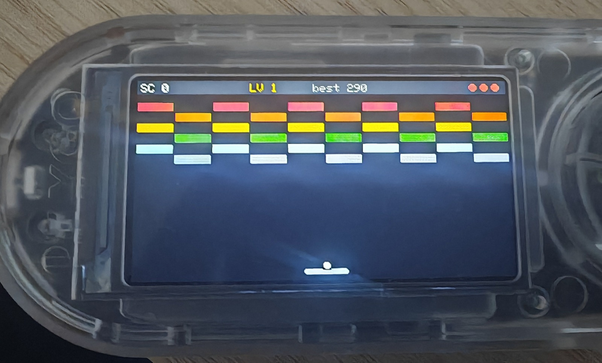
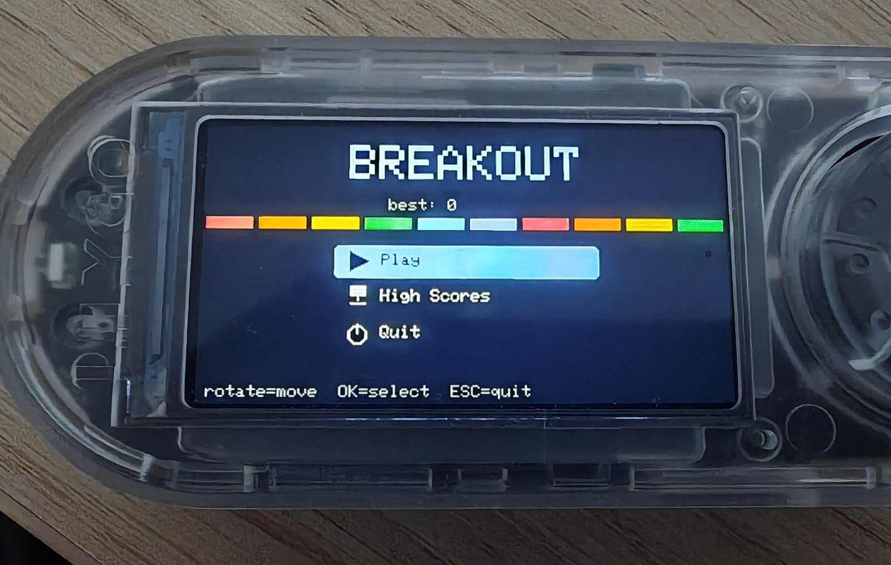
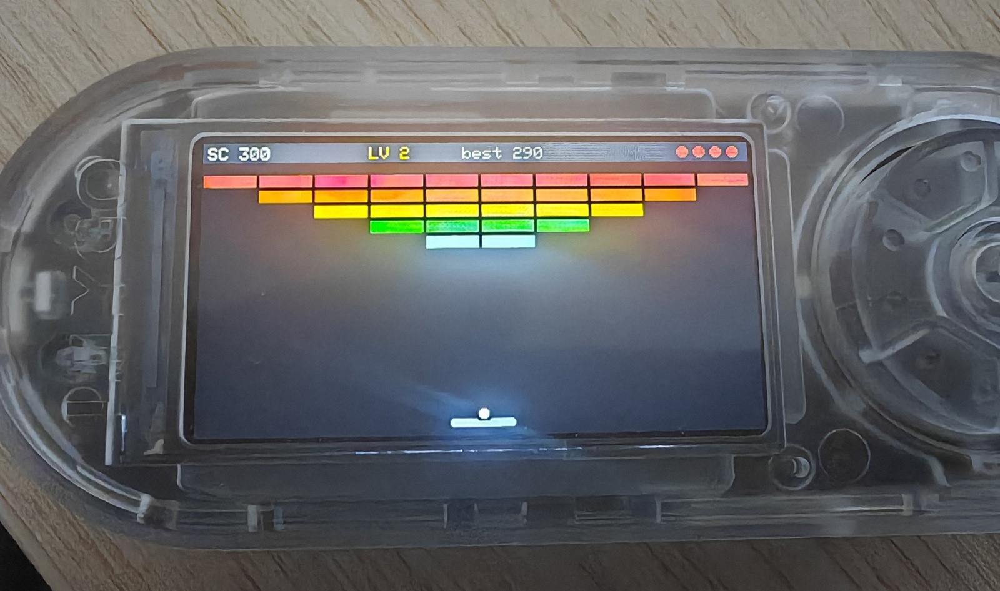
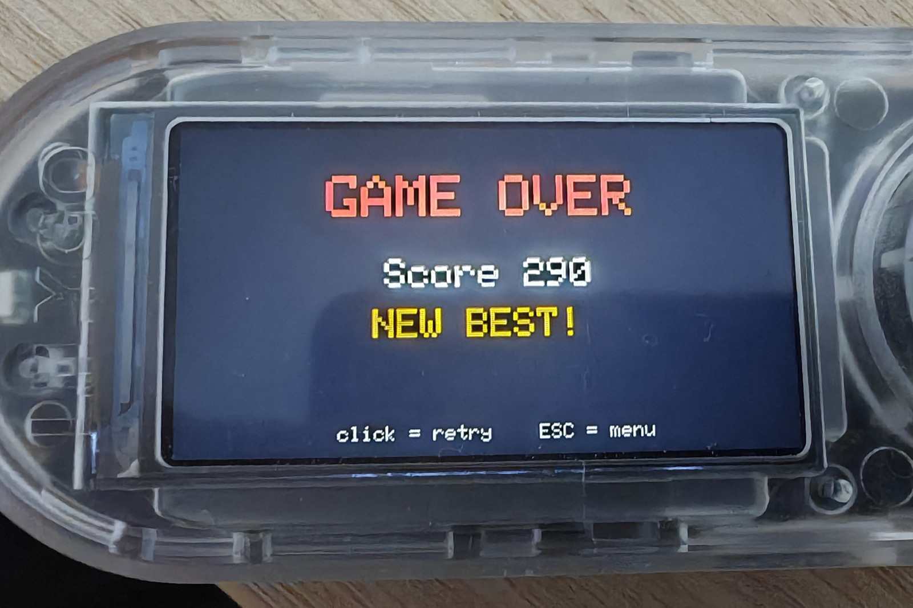

# 🧱 Breakout — Bruce / LilyGO T-Embed CC1101

🇺🇸 <a href="README.md">English</a> · 🇫🇷 <b>Français</b>

  [-F7DF1E)](https://github.com/BruceDevices/firmware) 

Un **casse-brique** coloré pour l'interpréteur JS de Bruce, pensé pour la molette. Des dispositions de niveaux qui changent, des bonus qui tombent des briques, des briques renforcées, et un tableau des 5 meilleurs scores sauvegardé.

## 🎮 Contrôles

**Molette = déplacer la raquette**, **clic = lancer la balle** (l'angle du rebond dépend de l'endroit où elle touche la raquette), **ESC = menu**.

## ✨ Fonctions

- 🧱 **Niveaux** — les dispositions s'enchaînent (pleine / damier / pyramide / bandes), une couleur par rangée, la balle accélère, et des **briques renforcées (2 coups)** apparaissent dès le niveau 3. Flash « LEVEL n ».
- 🎁 Des **bonus** tombent des briques — attrape-les avec la raquette :
  - **E** raquette plus large · **M** multi-balles (jusqu'à 3) · **S** balle ralentie (8 s) · **L** vie en plus
- ❤️ **3 vies**, affichage du score / niveau / record / vies.
- 🏆 **Top 5 des scores sauvegardé** (`/breakout_scores.json`) avec saisie de **3 initiales** en cas de record.
- 🖥️ Affichage incrémental sans scintillement, menu à pictos décoré d'une rangée de briques.

| Menu | Niveau 2 | Game over |
|---|---|---|
|  |  |  |

## 🚀 Installation

1. Copie **`Breakout.js`** sur la carte SD (par ex. `/scripts` ou `/BruceJS`).
2. Sur l'appareil : **JS Interpreter → sélectionne `Breakout.js`** (ou ajoute-le à tes favoris avec [bruce-launcher](https://github.com/koua29/bruce-launcher)).
3. Les meilleurs scores sont enregistrés dans `/breakout_scores.json` sur la SD.

## 🛒 Matériel

*Liens partenaires Amazon : si vous achetez via ces liens, le projet touche une petite commission, sans surcoût pour vous.*

<table>
<tr>
<td align="center" width="33%">
   
  <b><a href="https://www.amazon.fr/dp/B0D45MSMJR?linkCode=ll2&amp;tag=koua29bbreakout-21&amp;ref_=as_li_ss_tl">Batterie Anker 545 (10 000 mAh)</a></b> Pour faire tourner le T-Embed loin d'une prise
</td>
<td align="center" width="33%">
   
  <b><a href="https://www.amazon.fr/dp/B0C1FCZM94?linkCode=ll2&amp;tag=koua29bbreakout-21&amp;ref_=as_li_ss_tl">Antenne SMA 433 MHz (lot de 2)</a></b> Antenne sub-GHz pour la radio CC1101
</td>
<td align="center" width="33%">
   
  <b><a href="https://www.amazon.fr/dp/B0B7NVMBPL?linkCode=ll2&amp;tag=koua29bbreakout-21&amp;ref_=as_li_ss_tl">microSD SanDisk 64 Go (lot de 2)</a></b> Pour les thèmes, scripts et captures Bruce
</td>
</tr>
</table>

En tant que Partenaire Amazon, je réalise un bénéfice sur les achats remplissant les conditions requises.

## 🙏 Crédits & licence

- Script : **koua29**. Tourne sur l'excellent **[Bruce firmware](https://github.com/BruceDevices/firmware)**.
- Publié sous **licence MIT** — voir [LICENSE](LICENSE).

## ☕ Un café ?

