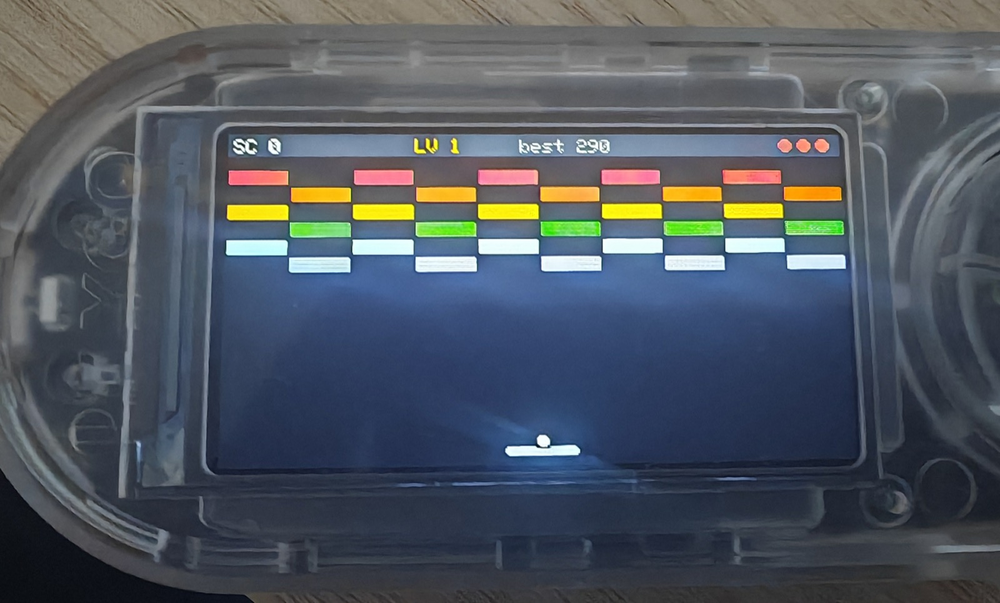
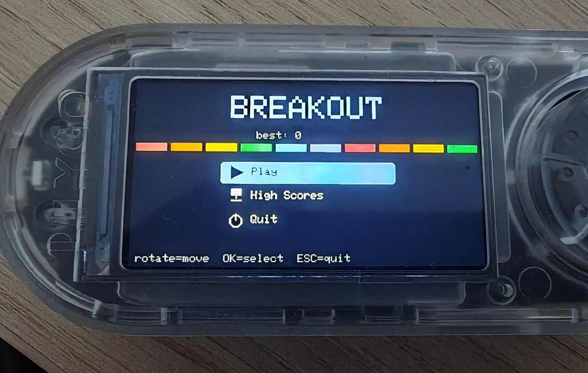
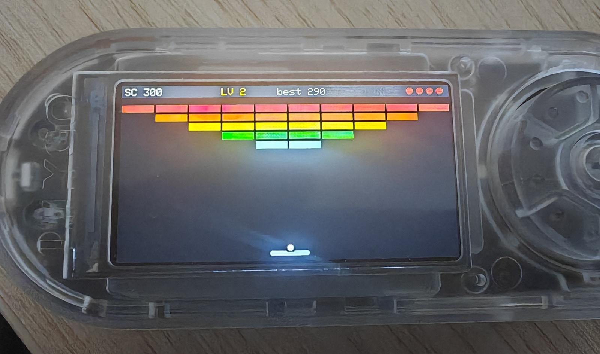
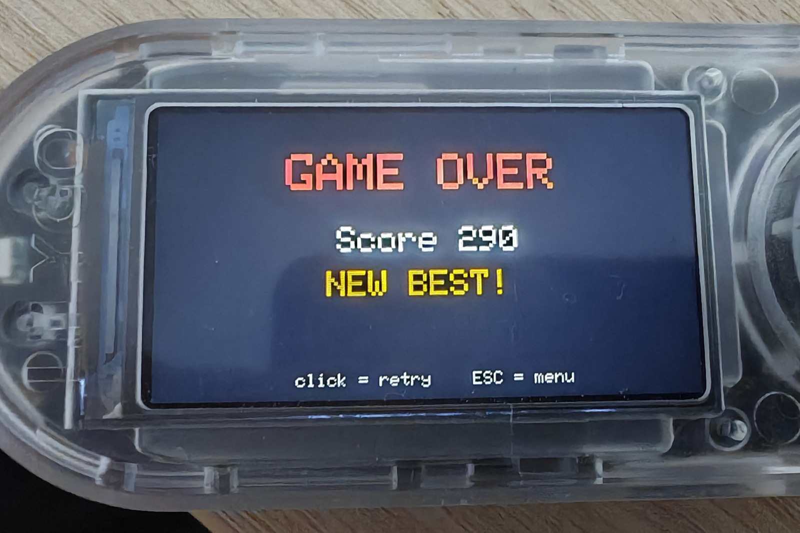

# 🧱 Breakout — Bruce / LilyGO T-Embed CC1101

🇺🇸 <b>English</b> · 🇫🇷 <a href="README.fr.md">Français</a>

  [-F7DF1E)](https://github.com/BruceDevices/firmware) 

A colorful **brick-breaker** for the Bruce JS interpreter, built around the rotary encoder. Changing level layouts, power-ups that drop from bricks, tough bricks, and a persistent top-5 high score table.

## 🎮 Controls

**Rotate = move the paddle**, **click = launch the ball** (the bounce angle depends on where it hits the paddle), **ESC = menu**.

## ✨ Features

- 🧱 **Levels** — layouts cycle (full / checker / pyramid / stripes), colors per row, ball speeds up, and **tough 2-hit bricks** appear from level 3. "LEVEL n" flash.
- 🎁 **Power-ups** drop from bricks — catch them with the paddle:
  - **E** wider paddle · **M** multi-ball (up to 3) · **S** slow ball (8 s) · **L** extra life
- ❤️ **3 lives**, HUD with score / level / best / lives.
- 🏆 **Persistent top-5 high scores** (`/breakout_scores.json`) with **3-initials** entry on a record.
- 🖥️ Flicker-free incremental rendering, picto menu decorated with a brick row.

| Menu | Level 2 | Game over |
|---|---|---|
|  |  |  |

## 🚀 Install

1. Copy **`Breakout.js`** onto the SD card (e.g. `/scripts` or `/BruceJS`).
2. On the device: **JS Interpreter → select `Breakout.js`** (or add it to your favorites with [bruce-launcher](https://github.com/koua29/bruce-launcher)).
3. High scores are stored in `/breakout_scores.json` on the SD.

## 🛒 Hardware

*Amazon affiliate links: if you buy through these links, the project earns a small commission at no extra cost to you.*

<table>
<tr>
<td align="center" width="33%">
   
  <b><a href="https://www.amazon.com/dp/B0D45MSMJR?linkCode=ll2&amp;tag=koua29bbreakout-20&amp;ref_=as_li_ss_tl">Anker 545 power bank (10,000 mAh)</a></b> Keeps the T-Embed running away from an outlet
</td>
<td align="center" width="33%">
   
  <b><a href="https://www.amazon.com/dp/B0C1FCZM94?linkCode=ll2&amp;tag=koua29bbreakout-20&amp;ref_=as_li_ss_tl">433 MHz SMA antenna (2-pack)</a></b> Sub-GHz antenna for the CC1101 radio
</td>
<td align="center" width="33%">
   
  <b><a href="https://www.amazon.com/dp/B0B7NVMBPL?linkCode=ll2&amp;tag=koua29bbreakout-20&amp;ref_=as_li_ss_tl">SanDisk 64 GB microSD (2-pack)</a></b> For Bruce themes, scripts and captures
</td>
</tr>
</table>

As an Amazon Associate I earn from qualifying purchases.

## 🙏 Credits & License

- Script: **koua29**. Runs on the excellent **[Bruce firmware](https://github.com/BruceDevices/firmware)**.
- Released under the **MIT License** — see [LICENSE](LICENSE).

## ☕ Buy me a coffee

